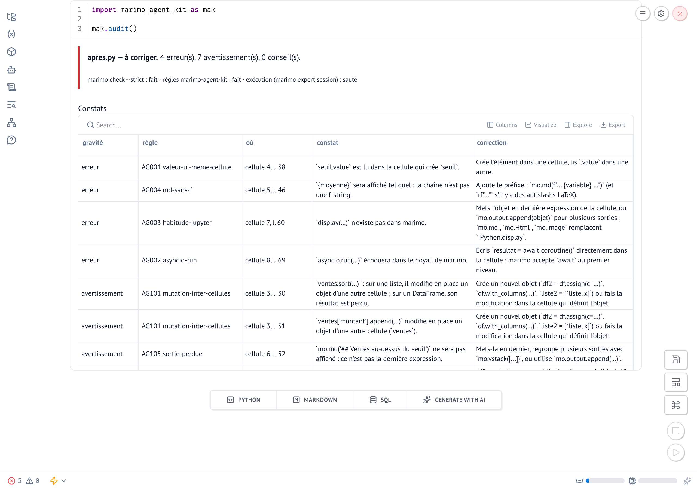

# marimo-agent-kit

Le kit aide un agent à écrire des notebooks marimo justes et lisibles. Il sert avec Claude Code,
Copilot, OpenCode, Codex et l'assistant intégré de marimo. Il contient ces éléments :

- un contrat d'écriture, et des contrôles qui trouvent ce que `marimo check` ne voit pas ;
- l'API de marimo lue dans la version installée ;
- trois skills, `marimo-agent-kit`, `wigglystuff` et `marimo-lens` ;
- un rapport qui s'affiche dans le notebook lui-même ;
- deux commandes pour brancher un LLM interne sans rien laisser sortir du poste ;
- un mode hors ligne par défaut : le kit ne contacte que les dépôts internes déclarés à uv ou
  pixi, et un fichier `mak.env` porte le proxy, les certificats et les consignes du poste.

La commande `mak` n'a pas de dépendance. Elle demande Python 3.10 ou plus, et marimo dans le
projet ou par `uvx`.

## Pourquoi

Le fichier `tests/exemples/mauvais.py` contient dix erreurs typiques d'un agent qui connaît mal
marimo. Voici ce que chaque contrôle y trouve.

| Contrôle | Résultat |
|---|---|
| `marimo check --strict` (0.25.2) | Aucun problème trouvé. |
| `python mauvais.py` | La première erreur, puis l'arrêt. |
| `mak verifier mauvais.py` | Les dix erreurs avant l'exécution, soit 4 erreurs et 6 avertissements. L'exécution confirme les trois cellules qui plantent. |

Les règles `AG001` à `AG210` visent les erreurs qui reviennent, et les règles `AG301` à `AG306`
ce qui touche à la sécurité du poste. En voici quelques-unes :

- lire `.value` dans la cellule qui crée l'élément d'interface ;
- écrire `mo.md("{x}")` sans le préfixe `f` ;
- modifier un objet qu'une autre cellule a créé ;
- ranger des éléments d'interface dans une liste Python ;
- écrire `if bouton.value:`, qui laisse des noms indéfinis ;
- appeler `asyncio.run`, qui passe en script et échoue dans l'éditeur ;
- appeler `display()`, ou laisser un secret en clair ;
- lancer une commande du shell, charger un pickle, ou construire `mo.Html` à partir de données
  sans les échapper.

Le fichier [`skills/marimo-agent-kit/reference/regles.md`](skills/marimo-agent-kit/reference/regles.md)
donne la liste complète et la raison de chaque règle.

Sur 21 notebooks de cours écrits par des agents puis relus, le kit ne trouve aucune erreur et un
seul avertissement. C'est un `AG304` sur un tableau HTML assemblé à partir de morceaux déjà
échappés, que la règle ne sait pas suivre. Le reste est fait de conseils de lisibilité.

## Contenu

| Élément | Utilisateur | Rôle |
|---|---|---|
| `mak verifier` | Tout agent, la CI, toi | Lance `marimo check` et lit tous ses constats en JSON, applique les règles, puis exécute chaque cellule par `marimo export session`. |
| `mak cellules` | Un agent qui va insérer des cellules | Applique les règles aux cellules proposées, dans le contexte du notebook. |
| `mak api` | Tout agent | Affiche la signature et la documentation d'un symbole de marimo installé. `--chercher` trouve un nom. |
| `mak widgets` | Tout agent | Affiche la doc de wigglystuff 0.6.0 sans réseau et la compare à la version installée. |
| `mak regles` | L'assistant de marimo, les agents | Affiche le contrat de quatorze règles que `[tool.marimo.ai] rules` transmet à l'assistant. |
| `mak mcp` | L'assistant de marimo en modes Ask et Agent, Claude Code, Copilot | Sert six outils MCP. |
| `skills/` | Les agents qui lisent des skills | Contient `marimo-agent-kit`, `wigglystuff` et `marimo-lens`. |
| `mak hook` | Claude Code, Copilot | Vérifie chaque notebook que l'agent écrit. Une erreur bloque l'agent, un avertissement lui est signalé. Au démarrage, donne le contexte réseau du poste. |
| `mak.audit()` | Toi, dans le notebook | Affiche le rapport et le message à renvoyer à l'agent. |
| `mak sonde-llm`, `mak confidentialite` | Toi, au travail | Testent ce qu'un LLM interne accepte, et ce qui sort du poste. |
| `mak contexte`, `mak marimo` | Les agents, toi | Disent le réseau du poste et ses consignes, et lancent marimo avec l'environnement du pack. |
| `mak garde` | Toi | Fait le bilan de la garde avant outil, ou juge une commande à l'essai. |
| `mak lancer -- commande` | Toi | Lance un outil, par exemple safeagents, avec le proxy et les certificats du pack. |

Les six outils MCP sont `verifier_notebook`, `verifier_cellules`, `api_marimo`,
`chercher_api_marimo`, `widgets_wigglystuff` et `regles_marimo`.

Le kit complète les outils de marimo-team sans les remplacer. Le skill officiel `marimo-notebook`
décrit le format. `marimo pair` sert à travailler dans le noyau. `marimo check` contrôle la
structure. Le paquet `marimo-lens` livre son propre mode d'emploi pour agents.

## Installer

Pour installer les skills seuls dans un agent qui lit le format Agent Skills, lance cette commande :

```bash
npx skills add auspect/marimo-agent-kit
```

Pour installer le greffon de Claude Code, tape ces commandes dans une session :

```text
/plugin marketplace add auspect/marimo-agent-kit
/plugin install marimo-agent-kit@marimo-agent-kit
```

Pour installer la commande `mak`, lance cette commande :

```bash
uv tool install "git+https://github.com/auspect/marimo-agent-kit"
```

Pour l'utiliser sans l'installer, lance cette commande :

```bash
uvx --from "git+https://github.com/auspect/marimo-agent-kit" mak verifier notebook.py
```

Au travail, ces commandes vont sur GitHub. Construis plutôt la roue une fois, dépose-la sur le
dépôt interne, puis installe-la depuis ce dépôt. Un fichier `src/marimo_agent_kit/mak.env` posé
avant `uv build` voyage dans la roue et sert de configuration par défaut à tous les postes. La
section [Hors ligne par défaut](#hors-ligne-par-défaut) décrit ce fichier.

```bash
uv build --wheel
```

```bash
uv tool install marimo-agent-kit
```

Dans un projet, l'installateur affiche d'abord ce qu'il ferait :

```bash
mak installer --skill agents --marimo --hook-claude
```

L'option `--appliquer` écrit les fichiers. L'installateur n'écrase jamais un fichier existant.

```bash
mak installer --skill agents --marimo --hook-claude --appliquer
```

Les options choisissent ce que l'installateur pose :

- `--skill agents`, `--skill claude` ou `--skill github` pose les trois skills dans `.agents/skills/`,
  `.claude/skills/` ou `.github/skills/`. `--seulement wigglystuff,marimo-lens` restreint la liste.
- `--marimo` ajoute le contrat et le serveur MCP à `pyproject.toml`. Le serveur MCP de l'assistant
  demande `marimo[mcp]` dans l'environnement qui lance marimo.
- `--hook-claude` ajoute trois hooks à `.claude/settings.json`. Le premier relit chaque notebook
  écrit. Le deuxième donne à l'agent le contexte réseau du poste au démarrage de la session. Le
  troisième est la garde avant outil. Copilot lit aussi ce fichier.
- `--mcp-claude` ajoute le serveur MCP à `.mcp.json`. Un serveur MCP lance du code chez toute
  personne qui ouvre le projet. Ne pose cette option qu'en connaissance de cause.

## Utiliser

Voici les commandes courantes :

```bash
mak verifier notebook.py
mak verifier notebook.py --sans-execution
mak verifier notebook.py --conseils --json
mak api mo.ui.table
mak api --chercher cache
mak widgets TangleDistribution
mak widgets --chercher lasso
echo '["df[\"c\"] = 1"]' | mak cellules --notebook notebook.py
```

`mak verifier` rend 0 sans erreur et 1 sinon. Le rapport dit quelles étapes ont tourné. Une étape
sautée ne compte pas comme une vérification.

Le rapport numérote les cellules dans l'ordre du fichier. La cellule setup, `with app.setup:`,
porte le numéro 0, et les autres cellules partent de 1. Le champ `cellule` du JSON et le texte
« cellule 2 » donnent le même numéro. `mak cellules` numérote les cellules proposées de 1 à n,
dans l'ordre de la liste.

Pour voir le rapport dans le notebook, ajoute cette cellule. Le kit doit être dans
l'environnement du notebook, par exemple avec
`uvx --with "git+https://github.com/auspect/marimo-agent-kit" marimo edit notebook.py`.

```python
import marimo_agent_kit as mak
mak.audit()
```

`mak.audit("autre.py", executer=True)` vérifie un autre notebook et exécute ses cellules.

| Sans le kit, marimo montre les cellules qui plantent | Avec `mak.audit()` en dernière cellule |
|---|---|
|  |  |

Les deux captures montrent `mauvais.py` dans l'éditeur de marimo 0.25.2, toutes cellules lancées,
dans une fenêtre de 1 280 pixels. Les erreurs silencieuses n'apparaissent que dans la seconde.
Ce sont le `mo.md` sans `f`, la mutation, la case à cocher non liée et le bouton sans effet.

### Widgets wigglystuff et marimo-lens sans réseau

Le skill `wigglystuff` aide à choisir un widget selon le besoin. Il embarque la doc de
wigglystuff 0.6.0, soit 71 pages et 93 démos, avec la signature et les traitlets lus dans le
paquet.

Le skill `marimo-lens` dit quand Lens aide et comment le monter. Il embarque les 19 pages de la
doc de marimo-lens 0.2.4. Le mode d'emploi pour agents reste celui du paquet, que cette commande
affiche :

```bash
python -c "import marimo_lens.agent as a; print(a.skill().body)"
```

Les deux docs viennent du commit de la version publiée. La branche principale de chaque projet
décrit déjà des fonctions qui ne sont pas publiées. Les scripts `outils/importer_wigglystuff.py`
et `outils/importer_marimo_lens.py` régénèrent ces docs. Leur mode d'emploi est en tête de chaque
script.

### Brancher un LLM interne dans l'assistant de marimo

marimo appelle un fournisseur personnalisé par l'API OpenAI `/chat/completions`. Il envoie la
clé dans les en-têtes `Authorization` et `api-key`. La sonde rejoue contre ton point d'accès les
quatre requêtes que marimo 0.25.2 envoie :

- le chat en mode Manual ;
- l'autocomplétion, avec `max_completion_tokens` ;
- la génération de cellule, avec `tool_choice: "required"` ;
- les modes Ask et Agent avec les outils du kit, avec `tool_choice: "auto"`.

La sonde dit ensuite quelles fonctions marcheront et affiche le bloc de configuration.

```bash
mak sonde-llm https://llm.interne/v1 mon-modele --cle-env LLM_INTERNE_CLE --ca /chemin/ca-entreprise.pem
```

L'environnement qui lance marimo a besoin de `pydantic-ai-slim[openai]`, que l'extra
`marimo[recommended]` installe. Il lui faut aussi une clé non vide, même factice.

### Ce qui sort du poste

marimo n'envoie aucune télémétrie d'usage. `marimo edit` contacte marimo.io une fois par jour pour
la version, et `MARIMO_SKIP_UPDATE_CHECK=1` coupe cet appel. Quatre fonctions envoient des données
dehors quand on les active : la recherche web du chat, le préréglage MCP `context7`, la
complétion Copilot et `marimo new "invite"`. Avec la variable posée, un proxy qui notait chaque
hôte n'a vu aucune connexion sortante, ni du serveur, ni du navigateur, ni de l'assistant branché
sur un LLM local.

```bash
mak confidentialite
```

Cette commande fait le bilan du poste et affiche les lignes à poser en PowerShell ou en bash. Le
kit pose lui-même `MARIMO_SKIP_UPDATE_CHECK=1` et `PYDANTIC_AI_NO_BANNER=1` sur chaque marimo
qu'il lance.

### Hors ligne par défaut

Au travail, un outil qui va sur le web déclenche des alertes de sécurité. Sans réglage, uv
contacte pypi.org à chaque lancement, même quand tout est en cache, et télécharge un Python
absent depuis github.com. Le kit ne contacte donc que les dépôts internes que uv ou pixi
déclarent déjà, par `uv.toml`, `UV_DEFAULT_INDEX` ou la configuration de pixi. La variable
`MAK_RESEAU` choisit le mode.

| Mode | Ce que font les outils du kit |
|---|---|
| `interne`, le défaut | uv passe par le dépôt interne déclaré. Sans dépôt interne, ou avec un dépôt public en plus, uv ne lit que son cache. uv ne télécharge un Python que depuis un miroir interne. Le bac à sable pixi ne sert que si pixi a un miroir interne. |
| `aucun` | Aucun accès réseau. uv ne lit que son cache et pixi ne sert pas. |
| `public` | uv et pixi gardent leur comportement par défaut, pypi.org compris. |

Un faux proxy qui note chaque hôte a servi de mesure. `mak verifier tests/exemples/propre.py`,
avec son bac à sable uv, ne contacte aucun hôte en modes `interne` et `aucun`. Avec un dépôt
Artifactory déclaré, il ne contacte que lui. En mode `public`, il contacte pypi.org.

Le fichier `mak.env` porte le reste : le proxy, l'autorité de certification, les variables propres
au pack et des consignes pour l'agent. Il contient une variable par ligne, au format `NOM=valeur`.

```bash
MAK_RESEAU=interne
HTTPS_PROXY=http://proxy.entreprise.local:8080
NO_PROXY=localhost,127.0.0.1,.entreprise.local
SSL_CERT_FILE=C:\certs\ca-entreprise.pem
UV_SYSTEM_CERTS=1
MAK_CONTEXTE=Les données de production restent sur le partage réseau. Ne les copie pas.
```

Le kit lit jusqu'à quatre fichiers. Le dernier l'emporte :

1. le `mak.env` livré dans le paquet, pour une roue construite par l'entreprise ;
2. `~/.config/marimo-agent-kit/mak.env`, ou `%APPDATA%\marimo-agent-kit\mak.env` sous Windows ;
3. le `mak.env` le plus proche du notebook ;
4. le fichier que nomme `MAK_CONFIG`.

Une variable déjà posée dans le shell garde sa valeur. Chaque ligne `MAK_CONTEXTE` ajoute une
consigne. Les variables vont à tout ce que le kit lance : `marimo check`, l'exécution, `mak api`,
la sonde LLM et `mak marimo`. Le kit masque l'identifiant et le mot de passe d'une adresse de
proxy dans ce qu'il affiche, mais le fichier reste en clair. N'y mets pas de mot de passe.

L'agent reçoit le contexte réseau de trois façons. Le hook de démarrage de Claude Code le lui
donne, l'outil MCP `regles_marimo` le rend avec le contrat, et le skill lui demande de lancer
`mak contexte`. Ce contexte lui interdit `pip install`, les options `--index-url`, les sources
`git+https` et la documentation en ligne. Il le renvoie vers `mak api`, `mak widgets` et les
références des skills. `mak contexte --detail` te montre d'où vient chaque réglage.

```bash
mak contexte --detail
```

`mak marimo` lance marimo avec le même environnement. L'assistant de marimo passe alors par le
proxy, et l'installation d'un paquet manquant suit le mode réseau.

```bash
mak marimo edit notebook.py
```

### Garde avant outil

La garde juge chaque commande de l'agent avant qu'elle tourne, dans Claude Code comme dans
Copilot, Windows compris. Elle vise ce que le contexte réseau interdit déjà en mots :

- `pip install` ;
- un index ou une source `git+` vers un hôte qui n'est pas déclaré interne ;
- `curl`, `wget` ou `Invoke-WebRequest` vers un tel hôte ;
- `npx` ;
- uv sans `--offline` quand le kit l'a coupé du réseau ;
- la recherche web, et la lecture d'une page externe.

Un hôte est interne s'il est déclaré : dépôt de uv ou de pixi, proxy, `NO_PROXY`,
`MAK_HOTES_INTERNES`, ou adresse privée. Un hôte public connu, comme pypi.org ou github.com, ne
l'est jamais. En mode réseau `public`, la garde ne juge rien.

`MAK_GARDE` règle son action. `observer`, le défaut, note ce qu'elle aurait refusé sans rien
bloquer. `agir` refuse et donne la raison à l'agent. `off` l'éteint. Le journal ne garde que la
règle, l'outil et un court extrait, dans `~/.local/state/marimo-agent-kit/garde.jsonl` ou
`%LOCALAPPDATA%\marimo-agent-kit\garde.jsonl`. Après quelques jours, lis le bilan. Si chaque
ligne est un vrai écart, passe en `agir`.

```bash
mak garde bilan
mak garde essai "uv pip install --index-url https://pypi.org/simple polars"
```

### Inspecter les appels d'outils de l'assistant avec safeagents (option)

safeagents, de Hugging Face, est un proxy entre l'assistant et l'API du modèle. Il juge chaque
appel d'outil avant qu'il tourne. Le mode Agent de l'assistant de marimo peut exécuter du Python
sur le poste : safeagents se place donc entre lui et le LLM interne. Le projet en est à la version
0.0, sans version publiée. Garde-le en option, jamais en réglage par défaut.

1. Construis la roue d'un commit que tu as relu, sur un poste qui a le droit d'aller sur GitHub.
   Dépose-la sur le dépôt interne, puis installe-la depuis lui par `uv tool install safeagents`.
   Le 15 novembre 2026, le commit `a8ee22d` a été essayé sous Windows avec un faux modèle.
2. Lance-le avec l'environnement du pack, pour qu'il passe par le proxy et lise l'autorité de
   certification. Garde son journal hors du dépôt, car il contient les arguments des appels.
   N'active aucun greffon `hf://`, car un greffon s'exécute dans le proxy.

   ```bash
   mak lancer -- safeagents https://llm.entreprise.local 8790 --journal ~/journaux/safeagents.jsonl
   ```

3. Fais pointer le fournisseur personnalisé de marimo sur `http://127.0.0.1:8790/v1`, et garde
   `127.0.0.1` dans `NO_PROXY`. Déclare `MAK_SAFEAGENTS=http://127.0.0.1:8790` dans `mak.env`.
   `mak confidentialite` signale alors chaque fournisseur qui ne passe pas par safeagents.
4. Vérifie la chaîne : les quatre essais doivent passer à travers safeagents.

   ```bash
   mak sonde-llm http://127.0.0.1:8790/v1 mon-modele --cle-env LLM_INTERNE_CLE
   ```

Sans modèle juge, safeagents laisse passer les constats de gravité moyenne. Il ne voit ni les
modèles servis par Copilot, ni les API Responses d'OpenAI et Gemini. La forme exacte de l'adresse
amont, avec ou sans `/v1`, n'a pas été vérifiée : la sonde le dira.

## Limites

- Les règles lisent la syntaxe, pas les types. `df.sort(...)` seul dans une cellule reçoit un
  avertissement ambigu, car c'est une liste modifiée en place ou un résultat de DataFrame perdu.
- La règle `AG203` signale un nombre écrit en dur dans un texte. Elle se trompe souvent sur des
  notebooks de cours. C'est un conseil à lire, pas une correction à appliquer partout.
- L'exécution écrit `__marimo__/session/<notebook>.json` à côté du notebook. Le dossier
  `__marimo__/` est d'ordinaire ignoré par git.
- La garde lit le texte des commandes. Une commande déguisée, par exemple un script Python qui
  télécharge, lui échappe. Elle ne remplace pas un bac à sable.
- Les règles `AG3xx` ne suivent pas les données d'une cellule à l'autre. `AG304` ne voit pas qu'un
  morceau de HTML a été échappé avant d'être assemblé ailleurs.
- La détection des miroirs de pixi lit sa configuration sans lancer pixi, absent des essais. Elle
  n'est pas vérifiée sur un vrai poste.
- Huit widgets wigglystuff chargent du JavaScript depuis un CDN dans le navigateur. Le skill
  `wigglystuff` les écarte hors du mode public, mais le kit ne le contrôle pas.
- Le kit vise marimo 0.25.2, wigglystuff 0.6.0 et marimo-lens 0.2.4. `marimo._code_mode` et les
  outils de l'assistant changent d'une version à l'autre.

## Développer

```bash
uv run --no-project --with marimo --with polars python -m unittest discover -s tests
uvx ruff check .
```

Le kit est sous licence Apache-2.0. Les docs recopiées gardent leur licence. wigglystuff est sous
MIT, voir `skills/wigglystuff/references/LICENSE-wigglystuff`. marimo-lens est sous Apache-2.0,
voir `skills/marimo-lens/references/LICENSE-marimo-lens`.
