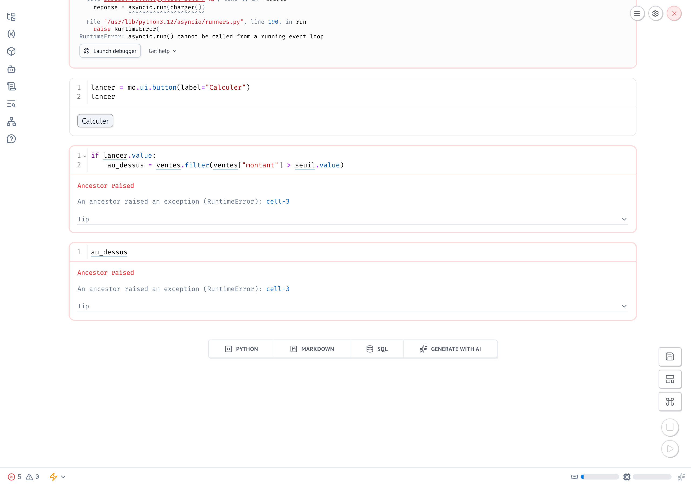

# marimo-agent-kit

Ce qu'il faut à un agent (Claude Code, Copilot, OpenCode, Codex, ou l'assistant intégré de
marimo) pour écrire des notebooks marimo justes et lisibles :

- un **contrat d'écriture** et des **contrôles** qui voient ce que `marimo check` ne voit pas ;
- l'**API de marimo** lue dans la version installée, au lieu d'être devinée ;
- trois **skills** : `marimo-agent-kit` (écrire et vérifier), `wigglystuff` (choisir un widget,
  doc hors ligne), `marimo-lens` (montrer du doigt un résultat) ;
- le **rapport dans le notebook** lui-même, et des outils pour brancher un LLM interne sans
  rien laisser sortir du poste.

Une commande, `mak`, sans dépendance : Python 3.10 ou plus, et marimo dans le projet (ou `uvx`).

## Pourquoi

Sur `tests/exemples/mauvais.py`, dix erreurs typiques d'un agent peu habitué à marimo :

| Contrôle | Ce qu'il voit |
|---|---|
| `marimo check --strict` (0.25.2) | rien : 0 problème |
| `python mauvais.py` | la première erreur seulement, puis s'arrête |
| `mak verifier mauvais.py` | les dix, avant exécution (4 erreurs, 6 avertissements) ; l'exécution confirme les trois cellules qui plantent |

Les règles (`AG001`…) visent ce qui revient : `.value` lu dans la cellule qui crée l'élément,
`mo.md("{x}")` sans `f`, mutation d'un objet d'une autre cellule, élément d'interface rangé dans
une liste Python, `if bouton.value:` qui laisse des noms indéfinis, `asyncio.run` (qui passe en
script et casse dans l'éditeur), `display()`, secret en clair, dépendance absente de l'en-tête
PEP 723… La liste et la raison de chacune : [`skills/marimo-agent-kit/reference/regles.md`](skills/marimo-agent-kit/reference/regles.md).

Sur 21 notebooks de cours écrits par des agents puis relus : aucune erreur, aucun
avertissement ; des conseils de lisibilité seulement.

## Ce qu'il y a dedans

| Couche | Pour qui | Comment |
|---|---|---|
| `mak verifier` | tout agent, la CI, toi | `marimo check --strict`, les règles, puis l'exécution de chaque cellule par `marimo export session` |
| `mak cellules` | un agent avant d'insérer des cellules (marimo pair, assistant) | les règles sur les corps proposés, dans le contexte du notebook |
| `mak api` | tout agent | signature et documentation de marimo installé ; `--chercher` pour trouver un nom |
| `mak widgets` | tout agent | doc de wigglystuff 0.6.0 hors ligne (pages, signatures, traitlets, démos), comparée à la version installée |
| Contrat (`mak regles`) | l'assistant de marimo, les agents | quatorze règles courtes, posées dans `[tool.marimo.ai] rules` |
| Serveur MCP (`mak mcp`) | l'assistant de marimo (modes Ask et Agent), Claude Code, Copilot | six outils : `verifier_notebook`, `verifier_cellules`, `api_marimo`, `chercher_api_marimo`, `widgets_wigglystuff`, `regles_marimo` |
| Skills (`skills/`) | agents à skills | `marimo-agent-kit`, `wigglystuff`, `marimo-lens` |
| Hook (`mak hook`) | Claude Code, Copilot | après chaque écriture d'un notebook : erreur → l'agent doit corriger ; avertissement → contexte |
| `mak.audit()` | toi, dans le notebook | une cellule qui montre le rapport et le message à renvoyer à l'agent |
| `mak sonde-llm`, `mak confidentialite` | toi, au travail | ce qu'un LLM interne accepte des requêtes de marimo ; ce qui sort du poste |

Le kit complète les outils de marimo-team, il ne les refait pas : le skill officiel
`marimo-notebook` pour le format, `marimo pair` pour travailler dans le noyau, `marimo check`
pour la structure, le mode d'emploi livré avec `marimo-lens` pour Lens.

## Installer

Les skills seuls, pour tout agent qui lit le format Agent Skills :

```bash
npx skills add auspect/marimo-agent-kit
```

Comme greffon de Claude Code (dans une session) :

```text
/plugin marketplace add auspect/marimo-agent-kit
/plugin install marimo-agent-kit@marimo-agent-kit
```

La commande `mak` (contrôles, serveur MCP, hook, doc hors ligne) :

```bash
uv tool install "git+https://github.com/auspect/marimo-agent-kit"
```

Sans rien installer :

```bash
uvx --from "git+https://github.com/auspect/marimo-agent-kit" mak verifier notebook.py
```

Puis, dans un projet, l'installateur dit ce qu'il ferait, et `--appliquer` l'écrit (rien n'est
écrasé) :

```bash
mak installer --skill agents --marimo --hook-claude
```

```bash
mak installer --skill agents --marimo --hook-claude --appliquer
```

- `--skill agents|claude|github` : les trois skills dans `.agents/skills/`, `.claude/skills/` ou
  `.github/skills/` ; `--seulement wigglystuff,marimo-lens` pour en choisir.
- `--marimo` : le contrat et le serveur MCP dans `pyproject.toml`. Le serveur MCP de l'assistant
  demande `marimo[mcp]` dans l'environnement qui lance marimo.
- `--hook-claude` : le hook dans `.claude/settings.json`.
- `--mcp-claude` : le serveur MCP dans `.mcp.json` (un serveur lance du code chez quiconque ouvre
  le projet : à poser en connaissance de cause).

## S'en servir

```bash
mak verifier notebook.py                  # tout : structure, règles, exécution
mak verifier notebook.py --sans-execution # rapide
mak verifier notebook.py --conseils --json
mak api mo.ui.table
mak api --chercher cache
mak widgets TangleDistribution            # page, signature, traitlets, démo
mak widgets --chercher lasso
echo '["df[\"c\"] = 1"]' | mak cellules --notebook notebook.py
```

Dans un notebook, une cellule montre le rapport du notebook lui-même, avec le message à
renvoyer à l'agent (le kit doit être dans l'environnement du notebook, par exemple
`uvx --with "git+https://github.com/auspect/marimo-agent-kit" marimo edit notebook.py`) :

```python
import marimo_agent_kit as mak
mak.audit()          # le notebook courant ; mak.audit("autre.py", executer=True)
```

| Sans le kit : marimo montre les cellules qui plantent | Avec `mak.audit()` en dernière cellule |
|---|---|
|  |  |

Les deux captures : `mauvais.py` dans l'éditeur marimo 0.25.2, toutes les cellules lancées,
fenêtre de 1 280 px, la dernière cellule en haut de l'écran. Les erreurs silencieuses (`mo.md`
sans `f`, mutation, case à cocher non liée, bouton sans effet) n'apparaissent que dans la seconde.

Code de sortie de `mak verifier` : 0 si aucune erreur, 1 sinon. Le rapport dit quelles étapes
ont tourné ; une étape sautée n'est pas une vérification.

### Widgets wigglystuff et marimo-lens, hors ligne

`skills/wigglystuff/` guide le choix d'un widget (tableau « besoin, widget, idéal pour, plutôt
autre chose si… ») et embarque la doc de wigglystuff 0.6.0 : 71 pages, 93 démos, signatures et
traitlets lus dans le paquet. `skills/marimo-lens/` dit quand Lens aide, comment le monter, et
embarque les 19 pages de la doc de marimo-lens 0.2.4 ; le mode d'emploi pour agents reste celui
livré avec le paquet (`uvx --with marimo-lens==0.2.4 agent-plugins read marimo-lens`).

Les deux docs viennent du commit de la version publiée, pas de la branche principale, qui décrit
déjà des fonctions non publiées. Pour les mettre à jour : `outils/importer_wigglystuff.py` et
`outils/importer_marimo_lens.py` (mode d'emploi en tête de chaque script).

### Brancher un LLM interne dans l'assistant de marimo

marimo appelle un fournisseur personnalisé en API OpenAI (`/chat/completions`), avec la clé dans
`Authorization` et `api-key`. La sonde rejoue les requêtes de marimo 0.25.2 contre ton point
d'accès et dit ce qui passe : chat (mode Manual), autocomplétion (`max_completion_tokens`),
génération de cellule (`tool_choice: "required"`), modes Ask et Agent avec les outils du kit
(`tool_choice: "auto"`). Elle propose ensuite le bloc de configuration.

```bash
mak sonde-llm https://llm.interne/v1 mon-modele --cle-env LLM_INTERNE_CLE --ca /chemin/ca-entreprise.pem
```

L'environnement qui lance marimo a besoin de `pydantic-ai-slim[openai]` (extra
`marimo[recommended]`) et d'une clé non vide, même factice.

### Ce qui sort du poste

marimo n'a pas de télémétrie d'usage, mais `marimo edit` contacte marimo.io une fois par jour
pour la version (`MARIMO_SKIP_UPDATE_CHECK=1` le coupe), et quelques fonctions sortent sur
demande : recherche web du chat, préréglage MCP `context7`, complétion Copilot,
`marimo new "invite"`. Mesuré derrière un proxy qui note les hôtes : avec la variable, ni le
serveur, ni le navigateur, ni l'assistant branché sur un LLM local ne contactent autre chose.

```bash
mak confidentialite
```

Le bilan du poste, et les lignes à poser en PowerShell ou en bash. Le kit pose lui-même
`MARIMO_SKIP_UPDATE_CHECK=1` et `PYDANTIC_AI_NO_BANNER=1` sur les marimo qu'il lance.

## Limites

- Les règles lisent la syntaxe, pas les types : `df.sort(…)` seul dans une cellule est signalé
  comme ambigu (liste modifiée en place, ou résultat de DataFrame perdu).
- `AG203` (nombre écrit en dur dans un texte) est bruyant sur des notebooks de cours : c'est un
  conseil, à lire, pas à appliquer partout.
- L'exécution écrit `__marimo__/session/<notebook>.json` à côté du notebook (le dossier
  `__marimo__/` est d'ordinaire ignoré par git).
- Écrit pour marimo 0.25.2, wigglystuff 0.6.0 et marimo-lens 0.2.4 ; `marimo._code_mode` et les
  outils de l'assistant changent d'une version à l'autre.

## Développer

```bash
uv run --no-project --with marimo python -m unittest discover -s tests
uvx ruff check .
```

Licence Apache-2.0. Les documentations recopiées gardent la leur : MIT pour wigglystuff
(`skills/wigglystuff/references/LICENSE-wigglystuff`), Apache-2.0 pour marimo-lens.
